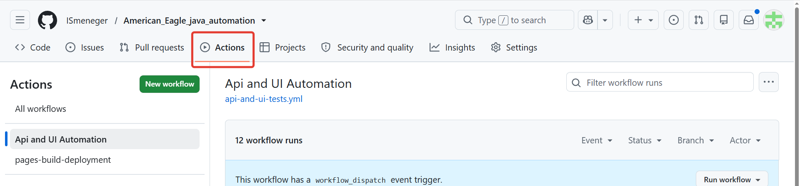
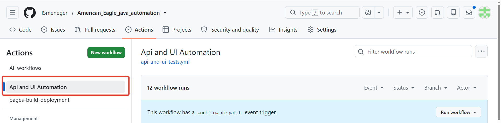
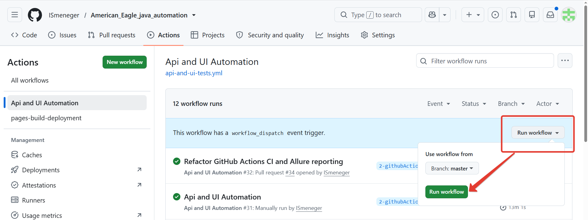
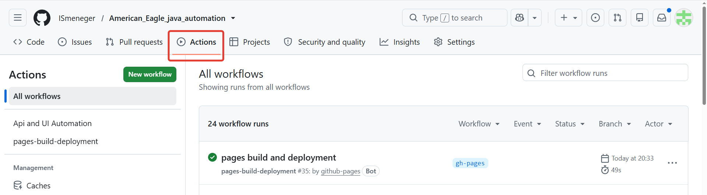
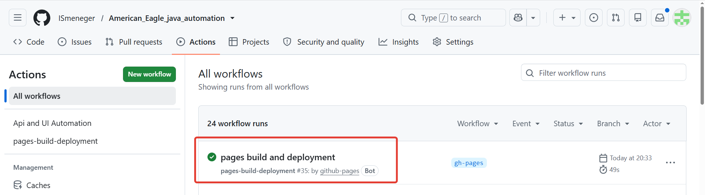
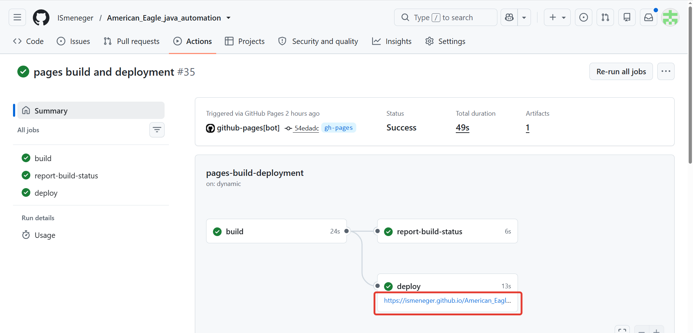
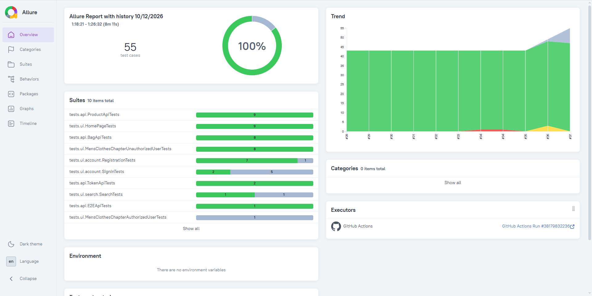

# American Eagle Java Automation

## 🧪 UI & API Test Automation Project

Автоматизированное тестирование реального e-commerce сайта [American Eagle](https://www.ae.com/us/en) с использованием **Java 21**, **Selenium WebDriver**, **REST Assured**, **JUnit 5**, **Gradle**, **GitHub Actions** и **Allure Report**.

[](https://www.java.com/)
[](https://junit.org/junit5/)
[](https://www.selenium.dev/)
[](https://rest-assured.io/)
[](https://gradle.org/)
[](https://github.com/features/actions)
[](https://allurereport.org/)

### 📊 Live Allure Report

➡️ **[Open Allure Report](https://ismeneger.github.io/American_Eagle_java_automation/)**

### ✅ Текущее состояние набора тестов

- **55 test cases** в полном JUnit-наборе;
- **20 API test cases**;
- **35 UI test cases**;
- из UI-набора **7 сценариев помечены `@Disabled`** из-за технических anti-bot ограничений;
- **1 UI-сценарий** выполняется через собственный `@KnownDefect` и при воспроизведении известного дефекта завершается как `aborted / skipped`;
- финальный **API suite** после последнего рефакторинга успешно пройден;
- финальный **UI suite** после последнего рефакторинга успешно пройден;
- API и UI запускаются раздельно и объединяются в единый **Allure Report**.

> Live Allure Report отражает последний опубликованный CI-запуск и обновляется после следующего успешного workflow.

---

<a id="contents"></a>
## 📚 Содержание

- [📌 О проекте](#project)
- [🛍 Об объекте тестирования](#system-under-test)
- [🧰 Технологический стек](#tech-stack)
- [🏗 Архитектура проекта](#architecture)
- [✅ Покрытие](#coverage)
- [⚠️ Ограничения production-сайта и Known Defect](#limitations)
- [📝 Тест-план](#test-plan)
- [🏷 Теги тестов](#tags)
- [🚀 Локальный запуск](#local-run)
- [🔐 Credentials](#credentials)
- [⚙️ GitHub Actions](#github-actions)
- [📊 Allure Report](#allure)
- [📦 Allure artifacts](#artifacts)
- [🧪 API E2E сценарий](#api-e2e)
- [📁 Структура проекта](#project-structure)
- [📈 CI/CD результат](#cicd-result)
- [👤 Автор](#author)

---

<a id="project"></a>
## 📌 О проекте

Этот репозиторий содержит **автоматизированные UI и REST API тесты** для сайта [American Eagle](https://www.ae.com/).

Проект первоначально был разработан в рамках выпускной работы по автоматизации тестирования и затем существенно доработан как самостоятельный **Java AQA pet project**.

Основные цели проекта:

- автоматизация пользовательских UI-сценариев;
- автоматизация REST API тестирования;
- позитивные и негативные проверки;
- API E2E lifecycle;
- работа с динамическими тестовыми данными;
- применение Page Object Model и reusable Steps;
- Controller / DTO подход для API;
- использование JUnit 5 Extensions;
- работа с реальным production-сайтом и динамическим DOM;
- разделение API и UI наборов;
- интеграция с GitHub Actions;
- формирование единого Allure Report;
- публикация отчётности через GitHub Pages.

[⬆️ К содержанию](#contents)

---

<a id="system-under-test"></a>
## 🛍 Об объекте тестирования

**American Eagle Outfitters, Inc. (American Eagle)** — крупный e-commerce / retail продукт.

Для автоматизации используется реальный действующий интернет-магазин:

➡️ [https://www.ae.com/](https://www.ae.com/)

С точки зрения Automation QA сайт интересен тем, что включает:

- большой каталог товаров и категорий;
- поиск и рекомендации;
- карточки товаров с различными SKU;
- регистрацию и авторизацию;
- пользовательские сессии;
- корзину и изменение её состояния;
- REST API;
- sale / regular prices;
- динамический контент;
- cookie banner, location modal и marketing / email overlays;
- anti-bot protection;
- различия поведения сайта при локальном и удалённом запуске.

Работа с production-сайтом позволяет решать реальные Automation QA задачи: синхронизацию, динамические тестовые данные, управление состоянием корзины, токены, нестабильность внешнего окружения, повторное получение элементов после DOM update и интеграцию автотестов с CI/CD.

[⬆️ К содержанию](#contents)

---

<a id="tech-stack"></a>
## 🧰 Технологический стек

| Технология | Назначение |
|---|---|
| **Java 21** | Основной язык проекта |
| **JUnit 5** | Тестовый фреймворк |
| **Selenium WebDriver 4.50.0** | UI-автоматизация |
| **REST Assured** | REST API тестирование |
| **AssertJ** | Fluent assertions |
| **Awaitility 4.3.0** | Ожидание eventual consistency в API |
| **Owner** | Управление конфигурацией |
| **Allure Report** | Тестовая отчётность |
| **Gradle 8.10** | Сборка и управление зависимостями |
| **Git / GitHub** | Контроль версий |
| **GitHub Actions** | CI |
| **GitHub Pages** | Публикация Allure Report |
| **Selenium Standalone Chrome** | Remote UI execution в CI |
| **IntelliJ IDEA** | Среда разработки |

[⬆️ К содержанию](#contents)

---

<a id="architecture"></a>
## 🏗 Архитектура проекта

В проекте используются:

- **Page Object Model**;
- отдельные `Page` и `Component` классы;
- reusable `Steps` слой;
- API `Controller` классы;
- DTO-модели;
- JUnit 5 Extensions;
- Owner configuration;
- `TokenManager` и support/helper слой;
- AssertJ / SoftAssertions;
- Awaitility;
- Allure annotations (`@Step`, `@Severity`);
- JUnit tags;
- Gradle tasks для запуска отдельных категорий тестов;
- централизованная конфигурация всех `Test` tasks через `tasks.withType(Test).configureEach`.

### UI-слой

```text
UI Test
  ↓
Steps
  ↓
Page / Component
  ↓
Selenium WebDriver
```

Page Objects и Components содержат локаторы и действия со страницами, Steps — переиспользуемые последовательности пользовательских действий, Tests — сценарии и assertions.

### API-слой

```text
API Test
  ↓
Controller
  ↓
DTO / Support / TokenManager
  ↓
REST Assured
```

API-контроллеры отвечают за HTTP-взаимодействие, а тесты — за проверку контрактов и бизнес-логики.

### JUnit 5 Extensions

В проекте используются JUnit 5 Extensions, в том числе:

- `GuestTokenExtension` — подготовка guest token для API-тестов;
- `KnownDefectExtension` — контролируемая обработка подтверждённого известного дефекта.

`KnownDefectExtension` работает по strict-модели:

- ожидаемая `AssertionError` → тест переводится в **aborted / skipped**;
- неожиданный успешный проход → тест **падает**, чтобы обратить внимание на возможное исправление дефекта;
- `TimeoutException`, `WebDriverException`, locator problems и другие технические ошибки **не маскируются** как Known Defect.

Это позволяет отличать реальное воспроизведение бага от инфраструктурного падения автотеста.

[⬆️ К содержанию](#contents)

---

<a id="coverage"></a>
## ✅ Покрытие

### UI

UI-набор содержит **35 test cases** и покрывает:

- главную страницу;
- browser title;
- header / navigation;
- footer;
- account panel;
- shopping bag;
- поиск существующего товара;
- известный negative search defect;
- регистрационную форму;
- invalid / empty email;
- пустые First Name / Last Name;
- пустой Password;
- пустой Zip Code;
- пустой Birthday;
- непринятые Terms and Conditions;
- sign-in validation;
- Men's Clothes каталог;
- открытие доступного товара;
- выбор размера;
- добавление товара в корзину;
- проверку сообщения `Added to bag!`;
- соответствие цены Product Page и Shopping Bag;
- поддержку sale / regular price;
- изменение quantity;
- subtotal;
- free shipping threshold;
- maximum quantity;
- удаление товара.

Для динамических страниц используются explicit waits, повторное получение элементов после DOM update и централизованная обработка optional overlays. В `BasePage` последовательно обрабатываются location modal, cookie banner и Bloomreach email popup.

### API

API-набор содержит **20 test cases**.

#### Token API

Проверяются:

- получение guest token;
- наличие `access_token`;
- `token_type`;
- `scope`;
- `expires_in`;
- guest token без `Authorization` → `401`.

#### Browse / Product API

Проверяются:

- получение товаров валидной категории;
- динамический выбор `productId`;
- получение доступных Product IDs;
- получение первого доступного SKU;
- поиск товара минимум с двумя SKU;
- invalid category;
- Browse без Bearer token → `401`.

#### Inventory API

Проверяются:

- Inventory по реальному `productId`;
- получение SKU;
- invalid product ID;
- Inventory без Bearer token → `401`.

#### Bag API

Проверяются:

- получение корзины;
- добавление товара;
- получение и проверка товара;
- изменение quantity;
- удаление;
- несколько разных товаров;
- invalid SKU;
- негативные сценарии;
- полный API E2E lifecycle.

Тестовые данные по возможности выбираются динамически, чтобы снизить зависимость от одного жёстко заданного товара или SKU.

Для API-сценариев с eventual consistency используется **Awaitility** вместо фиксированных `sleep`.

[⬆️ К содержанию](#contents)

---

<a id="limitations"></a>
## ⚠️ Ограничения production-сайта и Known Defect

Тесты выполняются на реальном production-сайте American Eagle.

Из-за этого автоматизация должна учитывать anti-bot protection, изменение данных, динамический DOM и внешнюю сетевую нестабильность.

### `@Disabled`: технически недоступные сценарии

Некоторые сценарии существуют в тестовом наборе, но не могут стабильно выполняться автоматически из-за anti-bot protection.

Например, успешная регистрация:

```java
@Disabled(
        "Automated account creation is blocked by the site's anti-bot protection. " +
                "Registration form filling works, but submission results in Access Denied."
)
```

`@Disabled` означает **техническое ограничение окружения**, а не дефект функциональности.

В текущем UI-наборе **7 test cases** имеют статус `@Disabled`.

### `@KnownDefect`: подтверждённый дефект поиска

American Eagle может возвращать товары / рекомендации даже для бессмысленного поискового запроса вместо ожидаемого no-results состояния.

Сценарий остаётся активным и помечается собственной аннотацией:

```java
@KnownDefect(
        "Search returns products for a non-existing query instead of showing no-results message"
)
```

Поведение:

- дефект воспроизвёлся через assertion failure → `aborted / skipped`;
- дефект неожиданно исчез → тест падает и требует перепроверки;
- Selenium/WebDriver/Timeout ошибки остаются обычными failures.

Таким образом, `@KnownDefect` не скрывает проблемы инфраструктуры или локаторов.

### Внешняя нестабильность

Так как SUT является внешним production-сайтом, возможны:

- медленная или нестабильная сеть;
- неполная загрузка ресурсов;
- повторная отрисовка DOM;
- `StaleElementReferenceException`;
- `TimeoutException`;
- временные WebDriver/navigation errors;
- повторное появление location / marketing popup;
- изменение доступности товаров;
- изменение sale / regular prices.

Поэтому в проекте используются explicit waits, повторное получение элементов и ограниченная retry-логика только там, где это оправдано.

[⬆️ К содержанию](#contents)

---

<a id="test-plan"></a>
## 📝 Тест-план

Для проекта подготовлен отдельный **Automation Test Plan**.

В документе описаны:

- цели автоматизации;
- UI и REST API scope;
- out of scope;
- типы и категории тестов;
- тестовые данные;
- управление состоянием;
- технологический стек;
- архитектура автоматизации;
- локальное и CI-окружение;
- API authorization;
- anti-bot ограничения;
- Known Defect подход;
- риски реального production-сайта;
- Allure Reporting;
- CI/CD стратегия;
- критерии успешного завершения.

📄 **[Открыть Test Plan (PDF)](src/test/resources/American_Eagle_TestPlan_2026.pdf)**

[⬆️ К содержанию](#contents)

---

<a id="tags"></a>
## 🏷 Теги тестов

В проекте используются JUnit 5 tags:

```text
UI
API
smoke
positive
negative
E2E
extended
```

Пример:

```java
@Tags({
        @Tag("API"),
        @Tag("negative")
})
```

Теги позволяют запускать разные группы тестов через Gradle tasks.

> Подтверждённый defect определяется собственной аннотацией `@KnownDefect`, а не обычным `@Tag("defect")`.

[⬆️ К содержанию](#contents)

---

<a id="local-run"></a>
## 🚀 Локальный запуск

Проект использует **Gradle Wrapper**, поэтому глобально установленный Gradle не требуется.

### Локальная настройка API credential

Для позитивных API-тестов требуется действующий guest Basic credential, разрешённый для тестирования. Java-клиент получает его **непосредственно из переменной окружения `AE_GUEST_AUTH`** через `System.getenv()`, без Gradle/JVM-параметров `-D`.

В Windows переменную можно настроить через **Свойства системы → Дополнительно → Переменные среды**. После изменения перезапустите IntelliJ IDEA.

Для текущего сеанса PowerShell (ввод не отображает значение):

```powershell
$secure = Read-Host "Enter AE_GUEST_AUTH (Basic ...)" -AsSecureString
$env:AE_GUEST_AUTH = [System.Net.NetworkCredential]::new("", $secure).Password
```

Значение должно начинаться с `Basic `. Не добавляйте credentials в исходники, командные аргументы или README.

Проверка наличия без вывода значения:

```powershell
[bool]$env:AE_GUEST_AUTH
```

### API

```powershell
.\gradlew apiTests --rerun-tasks
```

### UI

```powershell
.\gradlew uiTests --rerun-tasks
```

### Smoke

```powershell
.\gradlew smoke
```

### Positive

```powershell
.\gradlew positive
```

### Negative

```powershell
.\gradlew negative
```

### E2E

```powershell
.\gradlew e2e
```

### Combined UI + API

```powershell
.\gradlew allTests
```

### Стандартный Gradle test

```powershell
.\gradlew test --rerun-tasks
```

### Один конкретный тест

```powershell
.\gradlew test --tests "tests.api.TokenApiTests.getGuestTokenTest"
```

### Временная настройка guest credential

Для отдельного сеанса PowerShell задайте `AE_GUEST_AUTH` через защищённый ввод, как показано выше, и запускайте API suite обычной командой:

```powershell
.\gradlew apiTests --rerun-tasks
```

После выполнения можно очистить переменную текущего сеанса:

```powershell
Remove-Item Env:AE_GUEST_AUTH
```

### Опциональный parallel run Home Page

Для локального эксперимента существует отдельная задача:

```powershell
.\gradlew homePageTestsParallel
```

Она ограничена `HomePageTests`.

Глобальный parallel run всего UI-набора намеренно не используется: на реальном production-сайте и локальном Chrome параллельное выполнение показало меньшую стабильность.

### Gradle 9 compatibility

Для всех кастомных `Test` tasks централизованно задаются:

```groovy
testClassesDirs = sourceSets.test.output.classesDirs
classpath = sourceSets.test.runtimeClasspath
```

Это устраняет deprecated convention для custom `Test` tasks в Gradle 8.10 и подготавливает конфигурацию к Gradle 9.

Для Linux/macOS:

```bash
./gradlew <task>
```

[⬆️ К содержанию](#contents)

---

<a id="credentials"></a>
## 🔐 Credentials

Секретные значения не хранятся в исходном коде или Git history.

### Локально

Guest Basic credential передаётся через переменную окружения **`AE_GUEST_AUTH`**, а не через Gradle properties или JVM system properties. `TokenClient` читает её через `System.getenv("AE_GUEST_AUTH")`.

Устаревшее свойство `guestHeaderAuth` в личном `~/.gradle/gradle.properties` больше не используется; если оно сохранено, его следует удалить. Не выводите значение переменной в логи или Allure-вложения. В `TokenClient` отключён `AllureRestAssured` HTTP-filter для запросов токена; остальные HTTP-вложения также должны проверяться на отсутствие чувствительных данных.

### GitHub Actions

В CI guest credential хранится в **GitHub Repository Secrets** как:

- `AE_GUEST_AUTH`.

Для отдельных UI auth-сценариев CI также может использовать:

- `EMAIL`;
- `PASSWORD`.

Credentials не должны попадать в:

- Java-код;
- project-level / tracked `*.properties`;
- README;
- Allure attachments;
- Git history.

[⬆️ К содержанию](#contents)

---

<a id="github-actions"></a>
## ⚙️ GitHub Actions

Workflow разделяет API и UI на независимые jobs:

```text
api-tests ──► api-allure-results ──┐
                                   ├──► allure-report ──► GitHub Pages
ui-tests ───► ui-allure-results ───┘
```

### `api-tests`

Основные шаги:

- checkout репозитория;
- Java 21;
- Gradle setup;
- получение `AE_GUEST_AUTH` из GitHub Secrets;
- запуск API suite;
- сохранение `build/allure-results` как artifact.

Пример:

```bash
./gradlew apiTests
```

### `ui-tests`

Основные шаги:

- запуск Selenium Standalone Chrome;
- настройка remote WebDriver через `SELENIUM_REMOTE_URL`;
- передача UI credentials через GitHub Secrets при необходимости;
- запуск UI suite;
- сохранение UI Allure results.

### `allure-report`

После API и UI jobs:

1. скачиваются API Allure results;
2. скачиваются UI Allure results;
3. результаты объединяются;
4. восстанавливается Allure history;
5. формируется единый отчёт;
6. отчёт публикуется через GitHub Pages.

### ▶️ Как запустить workflow вручную

1. Перейдите в репозиторий **[American_Eagle_java_automation](https://github.com/ISmeneger/American_Eagle_java_automation)**.
2. Откройте вкладку `Actions`.

<p align="center">
  
</p>

3. Выберите workflow `Api and UI Automation`.

<p align="center">
  
</p>

4. Нажмите `Run workflow` и выберите нужную ветку.

<p align="center">
  
</p>

5. Дождитесь завершения jobs:

```text
api-tests ✅
ui-tests  ✅
      ↓
allure-report ✅
```

[⬆️ К содержанию](#contents)

---

<a id="allure"></a>
## 📊 Allure Report

После завершения workflow результаты API и UI тестов объединяются в единый **Allure Report** и публикуются через **GitHub Pages**.

### ➡️ [**Open Allure Report**](https://ismeneger.github.io/American_Eagle_java_automation/)

В отчёте можно посмотреть:

- общий результат запуска;
- API и UI suites;
- отдельные test cases;
- severity;
- tags;
- Allure steps;
- ошибки и stack traces;
- attachments;
- историю запусков.

### 📌 Публикация отчёта

<p align="center">
  
</p>

<p align="center">
  
</p>

<p align="center">
  
</p>

### 📈 Пример Allure Report

<p align="center">
  <a href="https://ismeneger.github.io/American_Eagle_java_automation/">
    
  </a>
</p>

> Нажмите на изображение, чтобы открыть актуальный Allure Report.

Локально:

```powershell
allure serve build/allure-results
```

или:

```powershell
allure generate build/allure-results --clean -o build/allure-report
allure open build/allure-report
```

[⬆️ К содержанию](#contents)

---

<a id="artifacts"></a>
## 📦 Allure artifacts

Каждый GitHub Actions run отдельно сохраняет:

- `api-allure-results`;
- `ui-allure-results`.

Затем оба artifacts объединяются отдельным job в единый Allure Report.

Так API и UI могут выполняться независимо, но сохраняют общую историю и отчётность проекта.

[⬆️ К содержанию](#contents)

---

<a id="api-e2e"></a>
## 🧪 Пример API E2E lifecycle

E2E API-тест проверяет полный lifecycle товара в корзине:

```text
получение guest token
        ↓
получение доступного productId
        ↓
получение доступного SKU через Inventory
        ↓
добавление товара в Bag
        ↓
проверка состояния Bag
        ↓
изменение quantity
        ↓
проверка обновлённого состояния
        ↓
удаление товара
        ↓
проверка удаления
```

Для проверки обновлённого состояния используется **Awaitility**.

[⬆️ К содержанию](#contents)

---

<a id="project-structure"></a>
## 📁 Структура проекта

Логическая структура тестовой части проекта:

```text
src
└── test
    ├── java
    │   ├── api
    │   │   └── controller
    │   ├── components
    │   ├── configs
    │   ├── constants
    │   ├── dto
    │   ├── enums
    │   ├── extensions
    │   ├── pages
    │   ├── steps
    │   ├── support
    │   ├── tests
    │   │   ├── api
    │   │   └── ui
    │   └── utils
    │
    └── resources
        ├── default.properties
        ├── dev.properties
        ├── test.properties
        └── American_Eagle_TestPlan_2026.pdf
```

Структура разделяет:

- UI Page Objects;
- UI Components;
- reusable Steps;
- API Controllers;
- DTO;
- JUnit Extensions;
- Owner configuration;
- support / helpers;
- API и UI test classes;
- resources / Test Plan.

[⬆️ К содержанию](#contents)

---

<a id="cicd-result"></a>
## 📈 CI/CD результат

В проекте реализовано:

- раздельное выполнение API и UI тестов;
- remote Selenium execution;
- Java 21;
- GitHub Secrets;
- сохранение Allure results;
- отдельные artifacts для API и UI;
- объединение результатов;
- Allure history;
- публикация через GitHub Pages;
- ручной запуск через `workflow_dispatch`.

Подтверждённый CI-запуск **[Api and UI Automation #38 (attempt 2)](https://github.com/ISmeneger/American_Eagle_java_automation/actions/runs/38773416345)**, коммит `f622400`, ветка `master`, 15 октября 2026 г.:

- `api-tests` — **Success**;
- `ui-tests` — **Success**;
- `allure-report` — **Success**;
- Allure — **55 test cases: 47 Passed, 8 Skipped/Aborted, 0 Failed/Broken**;
- общая длительность workflow — **10 мин 32 сек**.

Показатель 100% в Allure относится к выполненным тестам; восемь тест-кейсов пропущены или прерваны. В первой попытке запуска наблюдался UI timeout при открытии страницы, не воспроизведённый во второй попытке: причина не подтверждена.

После изменения способа передачи `AE_GUEST_AUTH` Java API suite успешно выполняется локально и в GitHub Actions. Собственные Gradle `Test` tasks настроены без устаревших conventions для `Test.classpath` и `Test.testClassesDirs`.

[⬆️ К содержанию](#contents)

---

## 🧩 Дополнительно

- ✅ Java 21
- ✅ JUnit 5
- ✅ Selenium WebDriver 4.50.0
- ✅ REST Assured
- ✅ Page Object Model
- ✅ Components
- ✅ Steps layer
- ✅ API Controllers / DTO
- ✅ JUnit 5 Extensions
- ✅ Owner
- ✅ AssertJ
- ✅ Awaitility
- ✅ Positive / Negative testing
- ✅ API E2E
- ✅ Authorization-negative API tests
- ✅ `@KnownDefect` / `KnownDefectExtension`
- ✅ Anti-bot-aware test strategy
- ✅ Location / cookie / email overlay handling
- ✅ Environment-based guest API credential configuration (`AE_GUEST_AUTH`)
- ✅ Gradle 9-ready custom Test task configuration
- ✅ Allure Report
- ✅ GitHub Actions CI
- ✅ GitHub Pages
- ✅ Gradle Wrapper
- ✅ Remote Selenium
- ✅ Test Plan

---

<a id="author"></a>
## 👤 Автор

**Ilya Sidorychev**

GitHub: [ISmeneger](https://github.com/ISmeneger)

Проект развивается как практический **Java QA Automation pet project** и часть профессионального AQA-портфолио.

[⬆️ К содержанию](#contents)
